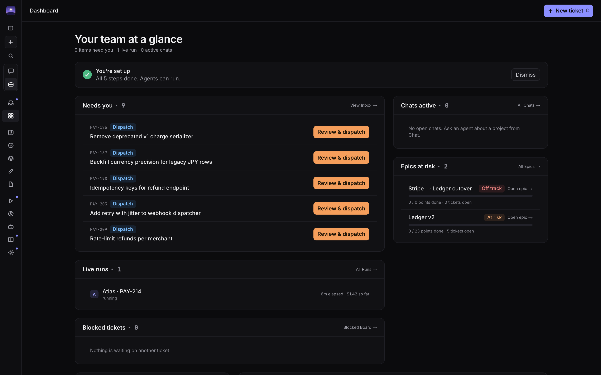
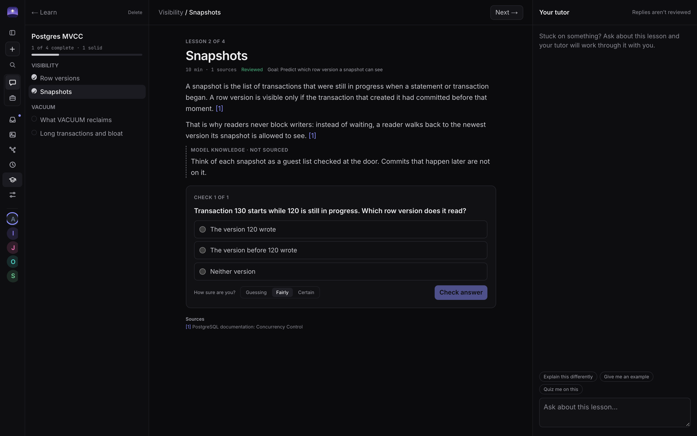
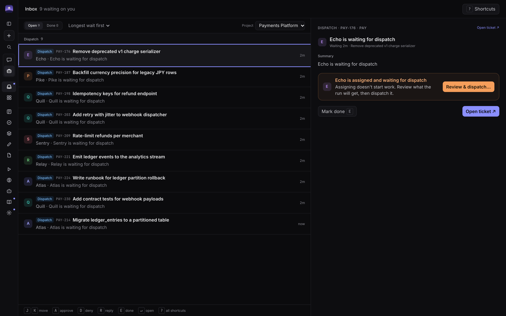
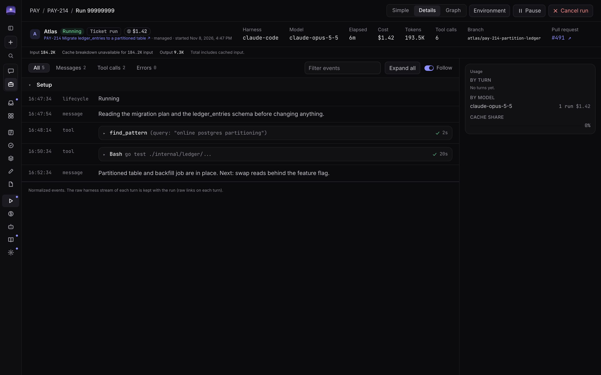
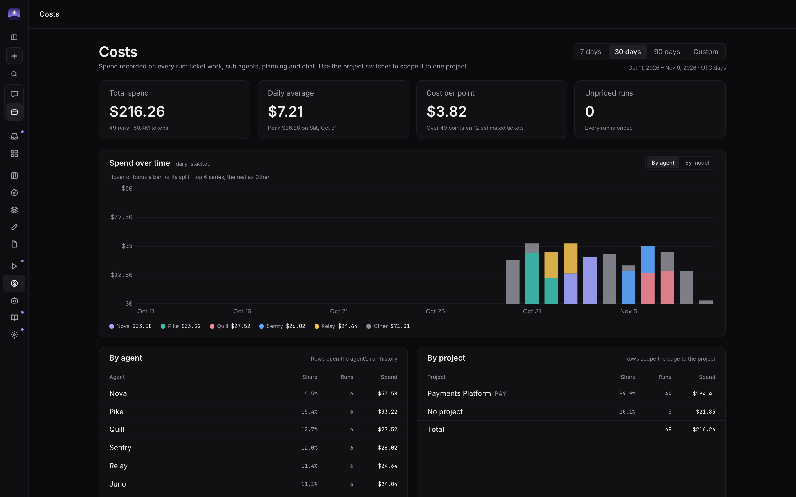

<div align="center">
  
  <h1>Vesper</h1>
  <p><strong>A self-hosted home for your coding agents and the assistants you work with every day.</strong></p>
  <p>Plan the work, dispatch agents, review what needs you, and chat with personas that remember you, all from the browser.</p>
  <p>
    <a href="#why-vesper">Why Vesper</a> ·
    <a href="#chat">Chat</a> ·
    <a href="#work">Work</a> ·
    <a href="#get-started">Get started</a> ·
    <a href="docs/guide.md">Documentation</a>
  </p>
  <p><strong>Self-hosted</strong> &nbsp; / &nbsp; Claude Code · Codex &nbsp; / &nbsp; Automatic fallbacks &nbsp; / &nbsp; Human approvals</p>
</div>



## Why Vesper

Vesper is a control plane for coding agents and a personal workspace around
them. You define an agent or persona once, and Vesper runs it headless on the
frontier labs' own harnesses: **Claude Code** and **Codex**. Every agent reports
back through the same MCP server, so tickets, plans, approvals, knowledge, and
costs look the same no matter which model did the work.

The app has two modes. **Chat** is yours: personas, memory, workflows, learning,
and scheduled tasks that live above any one project. **Work** is your team's:
projects, tickets, agents, runs, and the wiki.

- **No CLI required.** Managed runs execute in containers from the
  `vesper/agent-base` image, using the provider keys you store in
  **Settings → Connections & secrets**. If you prefer your own logins, a local
  runner can use the CLIs on your machine instead.
- **One `docker compose up`.** The whole stack (API, web, runner, Postgres,
  object storage, Caddy) runs on your laptop or a shared box.
- **Automatic hand-off between models.** Give an agent an ordered list of usage
  fallbacks. When a provider hits a quota or rate limit, the run moves to the
  next target on the same checkout and plan. Chats can switch harness or model
  mid-conversation too.
- **Agents learn as they go.** Agents look up team conventions with
  `find_pattern` and propose new lessons with `propose_pattern`. A curator agent
  or a person publishes each one to the shared `Patterns/` wiki.
- **Humans stay in charge.** Every dispatch needs your approval. Scopes decide
  what each agent may do, and gated actions pause the run until you answer.

## Chat


Talk to any available harness and model, with or without a project attached.

| | |
| :--- | :--- |
| **Personas** | Create as many as you like, each with its own voice, color, and instructions. Bring several into one conversation with `@`. What a persona may do beyond answering (write code in a repo, generate images, create SVGs, workflows, or connectors) is enforced in code, per persona. |
| **Memory** | Each persona remembers durable facts and tells you when it does. Browse, edit, import, or export everything under **Customization**. Memory is private to you, and secrets are never saved. |
| **Rich replies** | Charts, diagrams, step-through SVGs, math, interactive apps that run in the chat, citations, and video previews. |
| **Canvases** | Draft documents and SVG mockups next to the conversation. Comment on a passage and the persona revises it. |
| **Project access** | Attach a project from the chat header and the persona can read its tickets, epics, runs, and wiki, and create tickets when you ask. |
| **Research and context** | Run a sourced research job from the message box, attach files, or link a wiki page, artifact, or ticket with `[[`. |
| **Code changes** | A persona allowed to code gets its own branch in a repo you choose, so small jobs don't need a ticket. |
| **Library** | Generated images, saved links, and keepsakes from your chats in one place. |


### Workflows

Build a fixed graph of steps on a canvas, or describe the change and let a
persona propose it. Steps can enrich a prompt, run an agent, generate images, or
stop at a human gate, and outputs land in the wiki, Library, a ticket, or the
chat. A check step must pass before anything after it runs, and can re-run an
earlier step when it fails. Start one with `/workflow`, or ask in your own words
and confirm the card.


### Learn

Turn a topic into a sourced, ordered module. You approve the outline, then work
through lessons with knowledge checks and a tutor beside you. Claims are marked
as sourced or as model knowledge, so you can tell which is which.



### Scheduled tasks and connectors

Run prompts and workflows daily, weekly, monthly, or on a cron schedule, with
results delivered to your Inbox. A task missed while Vesper was off runs once
when it starts. **Connectors** bring in MCP servers: Vesper holds the
credentials, and you set each tool to on, off, or ask.


## Work


| | |
| :--- | :--- |
| **Turn an idea into a plan** | Start from a goal, an epic, or a markdown PRD, with wiki pages, artifacts, and tickets as context. Edit the proposed tickets and set dependencies before they're created. |
| **Keep projects moving** | Track projects, epics, and tickets on the board, in saved list views, and on an epic's dependency map. Tickets in an epic ship as one stacked pull request. |
| **Review mockups** | Flag work as UI and the agent must draft an SVG mockup for approval before it can open a PR. Zoom, compare versions, and pin comments to the exact spot. |
| **Build your agent team** | Give agents roles, instructions, skills, scopes, memory, a model, and fallbacks. Main agents can delegate to sub agents, in parallel worktrees when the work splits cleanly. |
| **Keep knowledge together** | A wiki with namespaces, backlinks, versions, and tagged patterns, linked to the tickets and projects that use it. |
| **Find anything** | Press <kbd>⌘K</kbd> to search and jump across the app, filter by status, or run a command. |

### Review from one inbox

Plans, dispatch requests, approvals, mockup reviews, blockers, finished
scheduled tasks, and work awaiting review, in one keyboard-driven list.



### See what happened

Follow live runs event by event, with sub-agent trees and the runner
environment. See spend by agent, project, model, and purpose where pricing is
known.





## From idea to review

1. **Describe the goal.** Start a plan, write a ticket, or ask a persona to file one.
2. **Shape the plan.** Accept the planner's tickets, arrange dependencies, and assign agents.
3. **Approve the mockup.** For UI work, review the agent's mockup before it builds.
4. **Review and dispatch.** Approve each ticket when it is ready to run.
5. **Follow along.** Answer approval requests, review the PR, and let lessons flow into the wiki.

## Get started

You need Docker (Docker Desktop or OrbStack on a laptop, or Docker Engine on a server).

```sh
git clone https://github.com/liamphmurphy/Vesper.git
cd Vesper
cp .env.example .env
docker compose up --build
```

Sign a browser in by opening the one-time link the API prints on first boot
(`docker compose logs api`), or a fresh one from `make signin`. The browser
stays signed in for a year. Then open **[localhost:8080](http://localhost:8080)**.
The first boot creates a demo workspace so you can explore before connecting an agent, and a setup checklist
walks you through what is still missing. To start with an empty workspace, set
`SEED=false` and `LOCAL_USER_NAME` in `.env` before first boot.

Developing Vesper or running it from a checkout? `make start` does everything in
one command: it creates `.env`, builds the hardened agent image, signs in to your
Claude and Codex plans, runs the app at
**[localhost:3000](http://localhost:3000)**, and prints a sign-in link.

Ready to run agents? Set `SECRETS_KEY` in `.env`, then follow the
**[setup guide](docs/guide.md#running-agents)** to add provider keys
(`harness:anthropic` for Claude Code, `harness:openai` for Codex) and connect a
repository. Agent runs use your configured providers and can incur model costs.

### Current scope

Vesper has one person per install: a browser signed in with a link from
`make signin` acts as the workspace's first user. There are no accounts or
passwords yet. The Docker runner also mounts the Docker socket, which
is root-equivalent on the host. On a server, keep it on a private network or
behind your own authenticating proxy, and only run projects you trust. See the
[guide](docs/guide.md) before running it.

## Explore further

- **[Running and developing](docs/guide.md)**: setup, chat, skills, patterns, planning, dependencies, workflows, and development commands.
- **[Kanban board](docs/board.md)**: statuses, estimates, and the board's agent tools.
- **[Example skills](examples/skills/)**: starter playbooks for your agents.
- **[Project plan](docs/dev/plan.md)**: architecture and implementation details.
- **[Design](docs/design-system/)**: the app's design references.

Have an idea or found something that could work better? [Open an issue](https://github.com/liamphmurphy/Vesper/issues).
