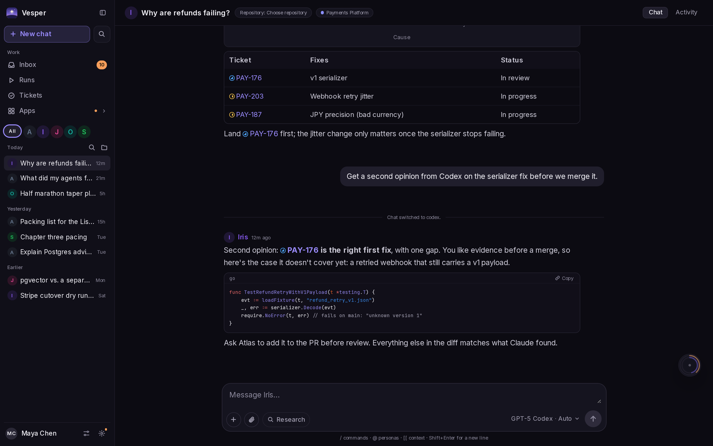
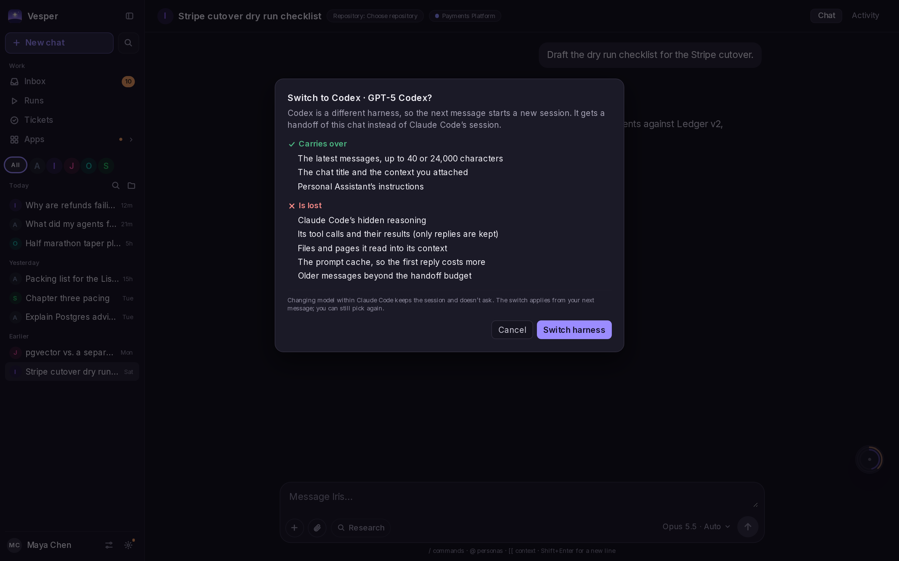
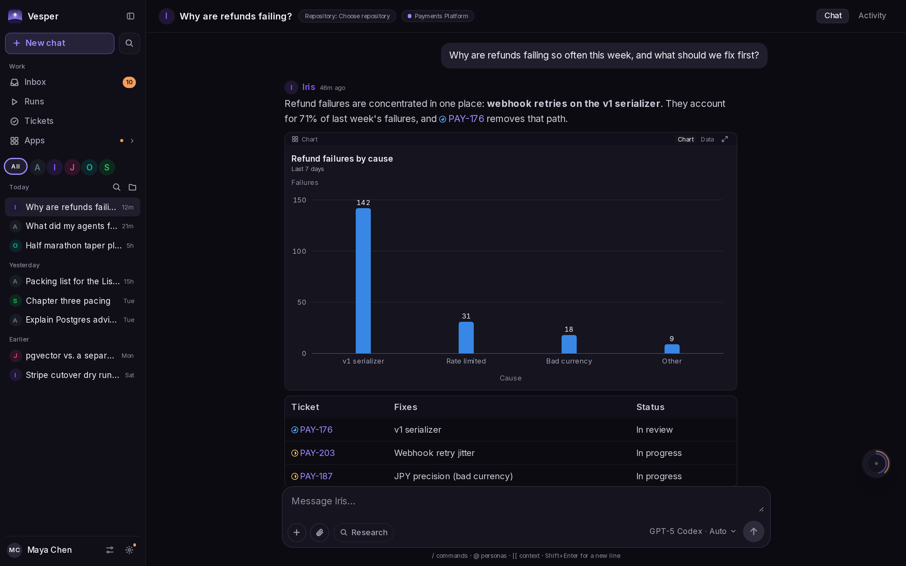
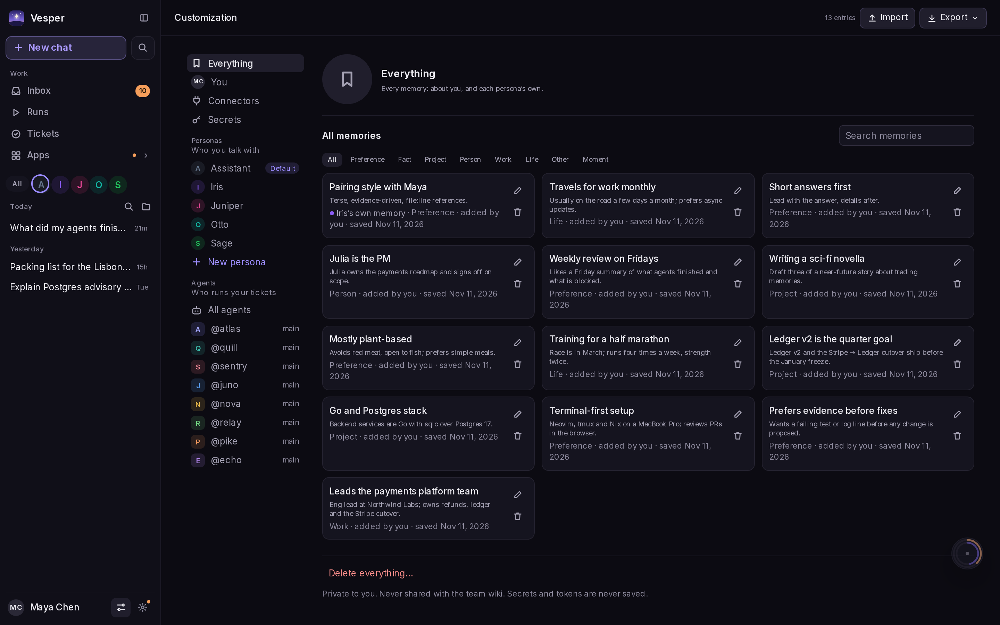
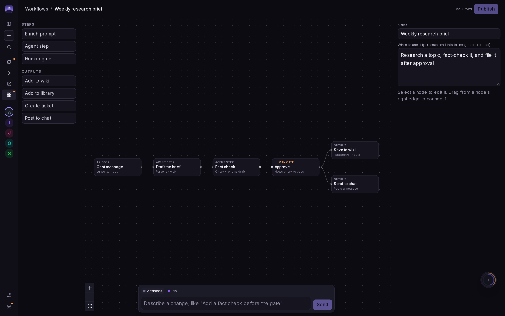
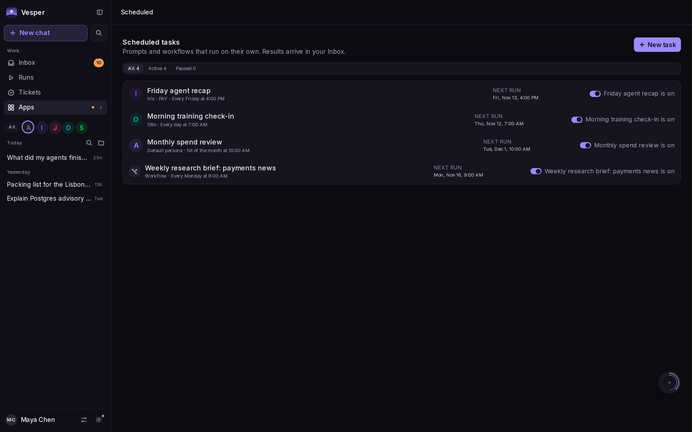
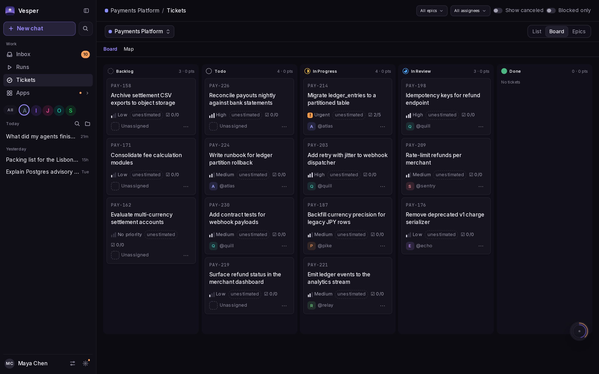

<div align="center">
  
  <h1>Vesper</h1>
  <p><strong>A frontier model chat-like experience, except memory, agent definitions, context, and more stay yours no matter the underlying harness you use.</strong></p>
  <p>Chat with Claude and GPT models through the labs' own harnesses, Claude Code and Codex, in a polished web app you host yourself. Switch harness mid-conversation and keep everything that makes the assistant yours.</p>
  <p>
    <a href="#why-vesper">Why Vesper</a> ·
    <a href="#switch-harness-keep-everything">Switch harness</a> ·
    <a href="#a-flagship-chat-app">Chat</a> ·
    <a href="#get-started">Get started</a> ·
    <a href="docs/guide.md">Documentation</a>
  </p>
  <p><strong>Self-hosted</strong> &nbsp; / &nbsp; Claude Code · Codex &nbsp; / &nbsp; Your memory, your Postgres &nbsp; / &nbsp; No lock-in</p>
</div>



## Why Vesper

The best frontier models are at their best inside their labs' own harnesses,
and the best chat apps keep your memory, instructions, and projects inside one
vendor's product. Try the other lab's model and you start over.

Vesper splits the two. It runs **Claude Code** and **Codex** headless as the
engine, and keeps everything that makes the assistant *yours* in your own
database:

| Stays yours | |
| :--- | :--- |
| **Memory** | What your personas learn about you, and what each one remembers about itself. Browse, edit, import, and export all of it. |
| **Personas** | Voice, instructions, color, and what each one may do (write code, make images, build workflows), enforced in code rather than in a prompt. |
| **Agent definitions** | Roles, instructions, skills, scopes, a model, and an ordered list of fallbacks, defined once and run on either harness. |
| **Context** | Your chats, projects, tickets, wiki, Library, and the files and links you attach. Every persona reads the same context, whatever model answers. |
| **Workflows and schedules** | Multi-step workflows, human approval gates, and scheduled prompts that don't care which lab runs a step. |

The harness becomes a choice you make per message, not a home you move into.

## Switch harness, keep everything



Pick any model the harnesses offer from the message box. Changing model within
a harness keeps the session. Changing harness hands the conversation to the
other one, with the persona, its memory, and your attached context intact, and
Vesper tells you up front what doesn't survive the move (the old harness's
hidden reasoning, tool results, and prompt cache).

Agents work the same way: give one an ordered list of fallbacks, and when a
provider hits a quota or rate limit the run moves to the next target on the same
checkout and plan.

## A flagship chat app



| | |
| :--- | :--- |
| **Rich replies** | Charts, Mermaid and SVG diagrams, step-through explainers, math, citations, video previews, and small interactive apps that run right in the chat. |
| **Canvases** | Draft documents and SVG mockups beside the conversation. Comment on a passage and the persona revises it. |
| **Research** | Run a sourced research job from the message box, attach files, or link a wiki page, artifact, or ticket with `[[`. |
| **Group chats** | Bring several personas into one conversation with `@`. |
| **Code** | A persona allowed to code works on its own branch in any GitHub repo your token can reach, runs the tests, opens a PR, and can start a live playground you open beside the chat. |
| **Images and video** | Personas allowed to can generate images (keeping a consistent likeness) and render videos, saved to your **Library**. |
| **Apps** | **Docs**, **Slides**, and **Finance**, with a persona beside you. In Docs its edits arrive as suggestions you accept or reject. |
| **Learn** | Turn a topic into a sourced module with lessons, knowledge checks, and a tutor. |
| **Temporary chats** | Talk without reading or writing memory; the chat is deleted after a day without messages. |

### Memory you can see



Each persona tells you when it saves something. Everything lives under
**Customization**: filter by type, edit or delete any entry, or export it all.
Memory is private to you, and secrets are never saved.

### Workflows and scheduled tasks



Build a fixed graph of steps on a canvas, or describe the change and let a
persona propose it. Steps can enrich a prompt, run an agent, generate images, or
stop at a human gate, and outputs land in the wiki, Library, a ticket, or the
chat. A check step must pass before anything after it runs. Start one with
`/workflow`, or ask in your own words and confirm the card.



Run prompts and workflows daily, weekly, monthly, or on a cron schedule, with
results delivered to your Inbox. **Connectors** bring in MCP servers: Vesper
holds the credentials, and you set each tool to on, off, or ask.

## Hand work to agents



When a job is bigger than a chat, ask your persona to file it. Tickets, epics,
and a board sit under **Work** in the same menu. Press **Start** on the card the
persona offers and an agent runs it in a container; the run follows
above the message box, and questions, approvals, and the finished PR come back
to the chat. Every dispatch needs your approval, scopes decide what each agent
may do, and agents propose lessons to a shared `Patterns/` wiki as they go.

## Get started

You need Docker (Docker Desktop or OrbStack on a laptop, or Docker Engine on a server).

```sh
git clone https://github.com/liamphmurphy/Vesper.git
cd Vesper
cp .env.example .env
docker compose up --build
```

Open **[localhost:8080](http://localhost:8080)** and choose a username and
password: the first browser to arrive sets up the install, and other devices
sign in with them. Locked out? `make signin` prints a one-time sign-in link.
The first boot creates an empty workspace and an Assistant with all persona
permissions enabled. After sign-in, the Assistant's Welcome Wizard asks for
your name and what you do, connects Claude Code or Codex, and drafts your first
persona. Settings → Run setup again starts it over. You can also set
`LOCAL_USER_NAME` and `LOCAL_USER_EMAIL` in `.env` before first boot. The demo
dataset is available only by opting in with `SEED=true`.

To chat and run agents, set `SECRETS_KEY` in `.env`, then follow the
**[setup guide](docs/guide.md#running-agents)** to add provider keys
(`harness:anthropic` for Claude Code, `harness:openai` for Codex). Runs use your
configured providers and can incur model costs.

Developing Vesper or running it from a checkout? `make start` does everything in
one command: it creates `.env`, builds the hardened agent image, signs in to
your **Claude and ChatGPT plans** so chats use the subscriptions you already
have, and runs the app at **[localhost:3000](http://localhost:3000)**.

### Current scope

Vesper has one person per install: the username and password chosen on first
visit sign in as the workspace's first user, and there are no other accounts.
The app listens on localhost only unless you set `LAZYAGENTS_BIND`. The Docker
runner also mounts the Docker socket, which is root-equivalent on the host. On a
server, keep it on a private network or behind your own authenticating proxy,
and only run projects you trust. See the [guide](docs/guide.md) before running it.

## Explore further

- **[Running and developing](docs/guide.md)**: setup, chat, skills, patterns, planning, dependencies, workflows, and development commands.
- **[Kanban board](docs/board.md)**: statuses, estimates, and the board's agent tools.
- **[Example skills](examples/skills/)**: starter playbooks for your agents.
- **[Project plan](docs/dev/plan.md)**: architecture and implementation details.
- **[Design](docs/design-system/)**: the app's design references.

Have an idea or found something that could work better? [Open an issue](https://github.com/liamphmurphy/Vesper/issues).
