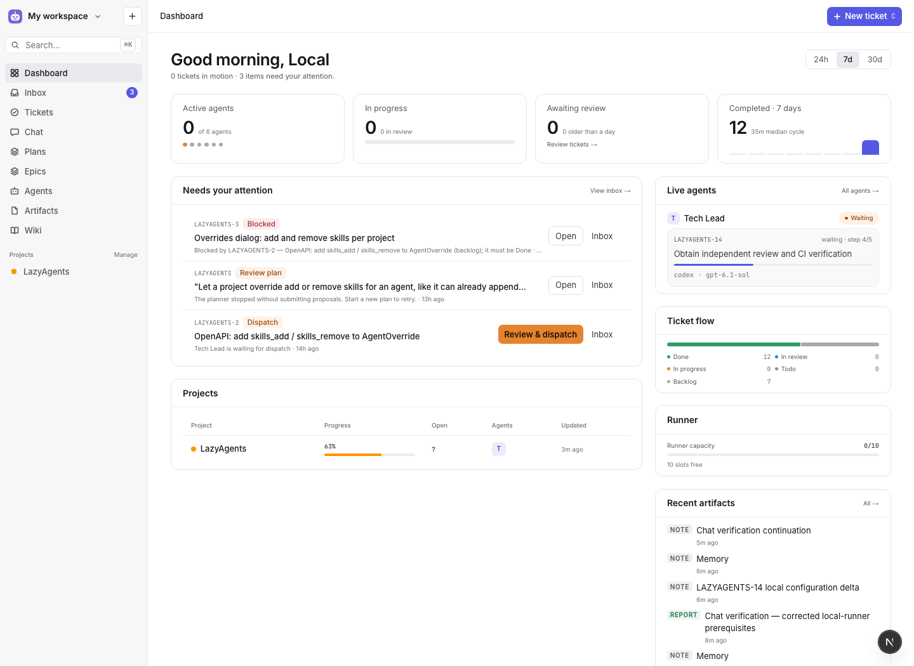

<div align="center">
  
  <h1>LazyAgents</h1>
  <p><strong>A home for your coding agents. A clear view of the work.</strong></p>
  <p>Plan projects, delegate tickets, and review what needs you — all in one place.</p>
  <p>
    <a href="#why-lazyagents">Why LazyAgents</a> ·
    <a href="#what-you-can-do">Features</a> ·
    <a href="#get-started">Get started</a> ·
    <a href="docs/guide.md">Documentation</a>
  </p>
  <p><strong>Self-hosted</strong> &nbsp; / &nbsp; Claude Code + Codex &nbsp; / &nbsp; Human approvals</p>
</div>



## Why LazyAgents?

Coding agents can do a lot. Keeping track of their work is another job entirely.

LazyAgents brings the work around your agents into one workspace: what to build,
who is working on it, what they know, and what needs your decision. Tickets,
plans, conversations, and project knowledge stay connected, so you can pick up
where you left off without piecing together terminal sessions.

The idea behind it is simple: spend less time coordinating agents and more time
deciding what is worth building. Give agents useful context and clear tasks,
then come back to a place that shows what happened and where you are needed.

## What you can do

| | |
| :--- | :--- |
| **Turn an idea into a plan** | Ask an agent to break down a goal, epic, or spec. Review and edit its proposals before creating tickets. |
| **Keep projects moving** | Organize work into projects, epics, and tickets. Dependencies make it clear what is ready and what is waiting. |
| **Build your agent team** | Give agents roles, instructions, reusable skills, and models. Run work with Claude Code or Codex, with optional usage fallbacks. |
| **Stay in the conversation** | Chat with agents and keep relevant project context close to the work. |
| **Keep knowledge together** | Connect wiki pages, documents, and artifacts to the tickets and projects that need them. Review suggested wiki edits. |
| **Review from one inbox** | Find plans, dispatch requests, approvals, blockers, and work awaiting review in one place. You approve each dispatch. |
| **See what happened** | Follow run activity, usage, costs where pricing is available, and project progress from the dashboard. |

## From idea to review

1. **Describe the goal.** Start a plan or write a ticket with the context an agent needs.
2. **Choose the team.** Assign agents and arrange dependencies.
3. **Review and dispatch.** Approve the work when it is ready to run.
4. **Follow along.** Check activity, respond to approval requests, and review the result.

## Get started

You need Docker (Docker Desktop or OrbStack on a laptop).

```sh
git clone https://github.com/liamphmurphy/LazyAgents.git
cd LazyAgents
cp .env.example .env
docker compose up --build
```

Open **[localhost:8080](http://localhost:8080)**. The first boot creates a demo
workspace so you can explore before connecting an agent. To start with an empty
workspace, set `SEED=false` and `LOCAL_USER_NAME` in `.env` before first boot.

Ready to run agents? Follow the **[setup guide](docs/guide.md#running-agents)**
to add provider credentials and connect a repository. Agent runs use your
configured providers and can incur model costs.

> **Current scope:** LazyAgents is built for a single developer's machine.
> There is no login yet, and the managed runner uses the Docker socket, which
> grants powerful access to the host. See the [guide](docs/guide.md) before running it.

## Explore further

- **[Running and developing](docs/guide.md)** — setup, skills, planning, dependencies, and development commands.
- **[Example skills](examples/skills/)** — starter playbooks for your agents.
- **[Project plan](PLAN.md)** — architecture and implementation details.
- **[Design](lazyagents-design/)** — the app's design references.

Have an idea or found something that could work better? [Open an issue](https://github.com/liamphmurphy/LazyAgents/issues).
